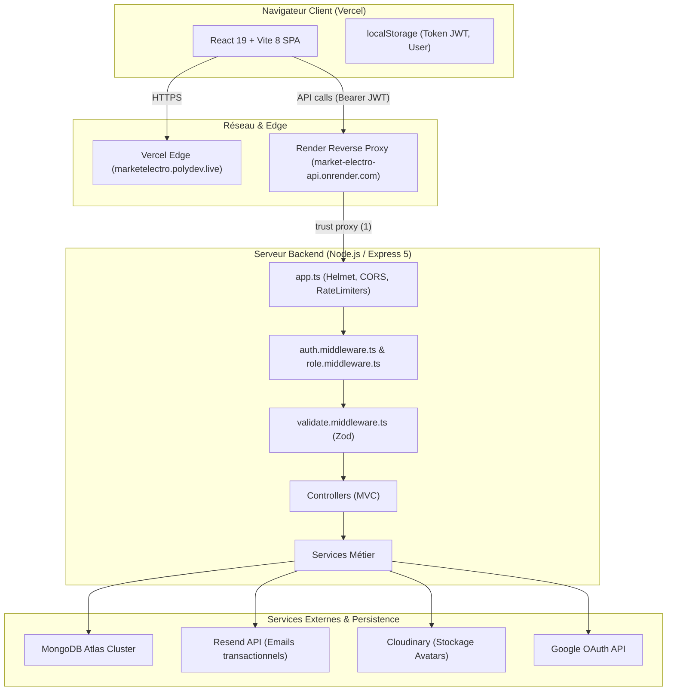

# 🛡️ Rapport d'Audit Complet de Cybersécurité — MarketElectro en Production

**Date de réalisation** : 15 Octobre 2026  
**Cible** : Application MarketElectro (CodeAlpha_FS_01)  
**Domaine de production cible** : `https://marketelectro.polydev.live`  
**Environnement audité** : Dépôt local synchronisé avec la branche de production  
**Méthodologie** : OWASP ASVS v4.0, OWASP API Security Top 10 (2023), OWASP WSTG v4.2  
**Statut de la phase** : **Phase 1 — Audit en lecture seule & Vérifications sûres** (Aucun fichier applicatif modifié)

---

## A. Résumé Exécutif

L'audit approfondi de cybersécurité du code source et de l'infrastructure de MarketElectro a révélé un projet ayant fait l'objet d'efforts substantiels de structuration (TypeScript, transactions atomiques MongoDB, hachage SHA-256 des tokens opaques, validation Zod partielle, intégration Google OAuth avec vérification stricte du jeton), mais présentant **plusieurs vulnérabilités critiques et élevées** qui mettent directement en péril la confidentialité des données, l'intégrité du service et la résilience en production.

### Principaux Constats & Risques

1. **Exposition critique de secrets dans le dépôt Git** : 
   - La chaîne de connexion MongoDB Atlas complète avec nom d'utilisateur et mot de passe en clair figure directement dans le fichier suivi par Git `backend/script/test-mongo-db.ts` ainsi que dans `backend/.env.example`.
   - L'historique Git contient plusieurs commits incluant le fichier `backend/.env` avec des secrets de production (URI Atlas, JWT_SECRET, clés d'API Cloudinary).
2. **Contournement des limites de requêtes (Rate Limiting Bypass) & Exposition involontaire de routes** :
   - `user.routes.ts` a dupliqué l'ensemble des routes d'authentification (`/register`, `/login`, `/forgot-password`, etc.) sous le préfixe `/api/users/`, sans aucun middleware de limitation de débit (`authLimiter`).
   - Un changement récent dans `app.ts` importe `auth.routes` sous le nom `contactRoutes` et l'enregistre sur `/api`, exposant directement `/api/login` et `/api/register` en contournant les protections d'authentification.
3. **Absence complète de passerelle de paiement en ligne** :
   - L'application permet à un utilisateur authentifié de déclencher un passage de commande (`POST /api/orders`) qui décrémente le stock et enregistre la commande en base sans aucune transaction financière, sans intégration de PSP (Stripe, PayPal, etc.) ni webhook de confirmation.
4. **Vulnérabilité critique de chaîne d'approvisionnement (`proxy-addr`)** :
   - La dépendance `proxy-addr` présente une vulnérabilité critique d'usurpation d'adresse IP (CVSS 9.1, CVE/GHSA-jqcg-44mw-7w3h), impactant directement la fiabilité du rate limiting basé sur l'IP en amont de Render (`trust proxy = 1`).
5. **Session et jetons sans révocation** :
   - Les tokens JWT ont une durée de vie de 7 jours, sont stockés dans le `localStorage` du navigateur, et ne disposent d'aucun mécanisme d'invalidation (aucun `tokenVersion` ou blacklist). Une réinitialisation de mot de passe n'invalide pas les sessions existantes.
6. **Médiation d'email et risque de consommation anticipée** :
   - Le composant frontend de vérification d'email (`VerifyEmail.tsx`) déclenche immédiatement la requête de validation en `useEffect` au chargement de la page, ce qui expose les liens à une consommation indue par les scanners de sécurité d'emails (Safe Links).

### Matrice d'Évaluation Globale

| Domaine | Niveau de Risque | Statut |
|---|---|---|
| **Gestion des Secrets & Données sensibles** | 🔴 **CRITIQUE** | Compromission confirmée dans l'historique et scripts |
| **Authentification & Gestion de Session** | 🟠 **ÉLEVÉ** | JWT 7j en localStorage, pas d'invalidation, bypass rate limit |
| **Contrôle d'Accès & Autorisations** | 🟡 **MOYEN** | Contrôles serveur admin fonctionnels ; routes dupliquées |
| **Validation des Entrées & API** | 🟠 **ÉLEVÉ** | Zod actif sur la majorité, mais endpoints critiques non validés |
| **Logique E-commerce & Paiement** | 🔴 **CRITIQUE** | Absence totale de paiement en ligne (commandes validées sans flux financier) |
| **Sécurité des Fichiers & Upload** | 🟡 **MOYEN** | Multer vérifie le Content-Type client sans vérifier la signature binaire |
| **En-têtes HTTP & Navigateur** | 🟠 **ÉLEVÉ** | Helmet actif côté backend ; 0 header de sécurité sur Vercel |
| **Disponibilité & DoS** | 🟠 **ÉLEVÉ** | Absence de pagination (dump complet du catalogue), vulnérabilité DoS |
| **Tests & Couverture** | 🔴 **CRITIQUE** | 0 test automatisé (0% de couverture) |

---

## B. Cartographie Détaillée de l'Architecture & des Flux

### 1. Architecture Applicative

### 2. Cartographie Complète des Routes API

| Méthode | Chemin API | Accès / Rôle | Validation | Traitement Métier | Données Sensibles | Statut & Risque |
|---|---|---|---|---|---|---|
| `POST` | `/api/auth/register` | Public | `registerSchema` (Zod) | Création utilisateur + Panier + Token vérification email | Mot de passe (haché bcrypt 10), Email | Limiteur `authLimiter` actif |
| `POST` | `/api/auth/login` | Public | `loginSchema` (Zod) | Vérification mot de passe + émission JWT | Mot de passe, JWT émis | Limiteur `authLimiter` actif |
| `POST` | `/api/auth/google` | Public | `googleLoginSchema` (Zod) | Validation Google ID Token + Création/Auth | Google Token, JWT émis | Limiteur `authLimiter` actif |
| `POST` | `/api/auth/verify-email` | Public | `verifyEmailSchema` (Zod) | Invalidation token opaque + activation compte + émission session | Token opaque, JWT | Limiteur `verificationLimiter` |
| `POST` | `/api/auth/resend-verification` | Public | `resendVerificationSchema` (Zod) | Génération nouveau token email + envoi Resend | Email, Token opaque | Anti-spam 60s en base |
| `POST` | `/api/auth/forgot-password` | Public | `forgotPasswordSchema` (Zod) | Génération token reset + envoi Resend | Email, Token reset | Réponse opaque anti-énumération |
| `POST` | `/api/auth/reset-password` | Public | `resetPasswordSchema` (Zod) | Validation token + hachage nouveau mot de passe | Nouveau mot de passe | N'invalide pas les JWT existants |
| `POST` | `/api/auth/verify-email-change` | Public | `verifyEmailChangeSchema` (Zod) | Validation token + mise à jour email | Token email, email | Consommation unique |
| `GET` | `/api/auth/profile` | Connecté | Aucun (Query/Body) | Retourne profil utilisateur connecté | Email, nom, rôle | Protégé par `authMiddleware` |
| `POST` | `/api/auth/contact` | Public | ❌ **Aucun Zod** | Envoi email direct à l'administrateur | Email, message libre | ⚠️ Risque de spam/flood de quota |
| `GET` | `/api/products` | Public | ❌ **Aucun schéma** | Récupération de tous les produits actifs | Données produits | ⚠️ Aucune pagination (Dump total) |
| `GET` | `/api/products/:id` | Public | `productIdSchema` (Zod) | Récupération d'un produit par ID | Données produit | Valide format ObjectId |
| `POST` | `/api/products` | Admin | `createProductSchema` (Zod) | Création d'un produit dans le catalogue | Données produit | Protégé admin |
| `PUT` | `/api/products/:id` | Admin | `updateProductSchema` (Zod) | Mise à jour partielle du produit | Données produit | Protégé admin |
| `DELETE` | `/api/products/:id` | Admin | `productIdSchema` (Zod) | Soft-delete (`isActive: false`) | ID produit | Protégé admin |
| `GET` | `/api/cart` | Connecté | Aucun | Récupération du panier de l'utilisateur | Produits et quantités | Isolé sur `req.user.id` |
| `POST` | `/api/cart` | Connecté | `addCartItemSchema` (Zod) | Ajout produit au panier avec contrôle stock | ID produit, quantité | Stock vérifié à l'ajout |
| `PUT` | `/api/cart/:productId` | Connecté | `updateCartItemSchema` (Zod) | Mise à jour quantité dans le panier | Quantité | ⚠️ Ne vérifie pas le stock ! |
| `DELETE` | `/api/cart/:productId` | Connecté | ❌ **Aucun Zod** | Suppression d'un article du panier | ID produit | Absence de validation de l'ID |
| `POST` | `/api/orders` | Connecté | ❌ **Aucun Zod** | Création commande + décrément stock atomique | Données commande | 🔴 Aucun paiement requis ! |
| `GET` | `/api/orders` | Connecté | Aucun | Liste des commandes de l'utilisateur | Historique commandes | Isolé sur `req.user.id` |
| `GET` | `/api/orders/:id` | Connecté | `orderIdSchema` (Zod) | Détail d'une commande de l'utilisateur | Données commande | Vérifie appartenance `user: userId` |
| `GET` | `/api/favorites` | Connecté | Aucun | Liste des favoris de l'utilisateur | IDs favoris | Isolé sur `req.user.id` |
| `POST` | `/api/favorites/:productId` | Connecté | ❌ **Aucun Zod** | Ajout d'un favori | ID produit | CastError Mongoose si non-ObjectId |
| `DELETE` | `/api/favorites/:productId` | Connecté | ❌ **Aucun Zod** | Retrait d'un favori | ID produit | CastError Mongoose si non-ObjectId |
| `GET` | `/api/users/me` | Connecté | Aucun | Récupération profil courant | Nom, email, avatar | Isolé sur `req.user.id` |
| `PUT` | `/api/users/me` | Connecté | `updateProfileSchema` (Zod) | Mise à jour nom complet uniquement | Nom complet | Pas de mass assignment possible |
| `PUT` | `/api/users/me/password` | Connecté | `changePasswordSchema` (Zod) | Changement de mot de passe (vérifie ancien) | Ancien et nouveau mot de passe | Haché bcrypt 10 |
| `PUT` | `/api/users/me/avatar` | Connecté | Multer memory | Upload image vers Cloudinary + suppression ancienne | Fichier binaire | ⚠️ MIME vérifié côté client uniquement |
| `POST` | `/api/users/me/email-change` | Connecté | `requestEmailChangeSchema` (Zod) | Génération token changement email + envoi | Email cible, mot de passe actuel | Vérifie mot de passe actuel |
| `POST` | `/api/users/me/google-link` | Connecté | ❌ **Aucun Zod** | Liaison compte Google au compte local | Google ID Token | ⚠️ Manque validation schéma corps |
| `POST` | `/api/users/register` | Public | `registerSchema` (Zod) | Copie non protégée de `/auth/register` | Identifiants | 🔴 Bypasse `authLimiter` |
| `POST` | `/api/users/login` | Public | `loginSchema` (Zod) | Copie non protégée de `/auth/login` | Identifiants | 🔴 Bypasse `authLimiter` |
| `POST` | `/api/users/forgot-password` | Public | `forgotPasswordSchema` (Zod) | Copie non protégée de `/auth/forgot-password` | Email | 🔴 Bypasse `emailActionLimiter` |
| `POST` | `/api/register` | Public | `registerSchema` (Zod) | Exposition racine via `contactRoutes` dans `app.ts` | Identifiants | 🔴 Bypasse `authLimiter` |
| `POST` | `/api/login` | Public | `loginSchema` (Zod) | Exposition racine via `contactRoutes` dans `app.ts` | Identifiants | 🔴 Bypasse `authLimiter` |
| `GET` | `/api/dashboard/user` | Client | Aucun | Statistiques et commandes récentes client | Agrégats commandes | Filtré sur rôle customer |
| `GET` | `/api/admin/dashboard` | Admin | Aucun | Statistiques globales, CA, alertes stock | Données globales plateforme | Protégé `authorizeRoles('admin')` |
| `GET` | `/api/admin/products` | Admin | Aucun | Liste intégrale des produits (avec inactifs) | Catalogue admin | ⚠️ Aucune pagination |
| `GET` | `/api/admin/orders` | Admin | Aucun | Liste intégrale de toutes les commandes | Commandes de tous les clients | ⚠️ Aucune pagination |
| `GET` | `/api/admin/orders/:id` | Admin | `orderIdSchema` (Zod) | Détail commande client quelconque | Données complètes commande | Protégé admin |
| `PUT` | `/api/admin/orders/:id/status`| Admin | `updateOrderStatusSchema` (Zod) | Transition de statut commande (pending/confirmed/cancelled)| Statut | Gestion atomique réincrément stock |
| `GET` | `/api/admin/users` | Admin | Aucun | Liste intégrale des clients avec CA généré | Nom, email, historique | ⚠️ Aucune pagination |
| `GET` | `/api/admin/settings/store` | Admin | Aucun | Récupération paramètres boutique | Configuration magasin | Protégé admin |
| `PUT` | `/api/admin/settings/store` | Admin | `updateStoreSettingsSchema` (Zod) | Mise à jour paramètres boutique | Configuration magasin | Protégé admin |
| `POST` | `/api/messages` | Client | `createConversationSchema` (Zod) | Création fil de discussion support | Sujet, message | ℹ️ Non utilisé par le frontend |
| `GET` | `/api/messages/my` | Client | Aucun | Liste conversations client | Messages | ℹ️ Non utilisé par le frontend |
| `GET` | `/api/messages/my/:id` | Client | ❌ **Aucun Zod** | Détail conversation client | Messages | ℹ️ Non utilisé par le frontend |
| `GET` | `/api/messages/admin` | Admin | Aucun | Liste toutes conversations support | Messages | ℹ️ Non utilisé par le frontend |
| `POST` | `/api/messages/admin/:id/reply`| Admin | `createReplySchema` (Zod) | Réponse admin à une conversation | Réponse | ℹ️ Non utilisé par le frontend |
| `PUT` | `/api/messages/admin/:id/close`| Admin | ❌ **Aucun Zod** | Fermeture fil de support | Statut conversation | ℹ️ Non utilisé par le frontend |

---

## C. Tableau Détaillé des Vulnérabilités & Faiblesses Identifiées

| ID | Titre | Sévérité | Certitude | Fichier & Emplacement | OWASP |
|---|---|---|---|---|---|
| **SEC-01** | Identifiants MongoDB Atlas et Secrets exposés dans le dépôt & l'historique Git | 🔴 **Critique** | **Confirmée** | [`backend/script/test-mongo-db.ts:L3`](file:///c:/Users/DELL/Downloads/SEMESTRE2025-2026/CODEALPHA/task1/backend/script/test-mongo-db.ts#L3), [`backend/.env.example:L2`](file:///c:/Users/DELL/Downloads/SEMESTRE2025-2026/CODEALPHA/task1/backend/.env.example#L2), Git commits `f64f921`, `4708166` | A02:2021 / API8:2023 |
| **SEC-02** | Absence complète de passerelle de paiement (Commandes créées sans flux financier) | 🔴 **Critique** | **Confirmée** | [`frontend/src/pages/CheckoutPage.tsx:L50-L69`](file:///c:/Users/DELL/Downloads/SEMESTRE2025-2026/CODEALPHA/task1/frontend/src/pages/CheckoutPage.tsx#L50-L69), [`backend/src/services/order.services.ts:L8-L101`](file:///c:/Users/DELL/Downloads/SEMESTRE2025-2026/CODEALPHA/task1/backend/src/services/order.services.ts#L8-L101) | API6:2023 / Business Logic Flaw |
| **SEC-03** | Vulnérabilité Critique d'usurpation d'IP dans `proxy-addr` (Bypass de Rate Limiting) | 🔴 **Critique** | **Confirmée** | `node_modules/proxy-addr` (GHSA-jqcg-44mw-7w3h), [`backend/src/app.ts:L29`](file:///c:/Users/DELL/Downloads/SEMESTRE2025-2026/CODEALPHA/task1/backend/src/app.ts#L29) | A06:2021 / API4:2023 |
| **SEC-04** | Contournement du Rate Limiting d'authentification par routes dupliquées | 🟠 **Élevée** | **Confirmée** | [`backend/src/routes/user.routes.ts:L97-L150`](file:///c:/Users/DELL/Downloads/SEMESTRE2025-2026/CODEALPHA/task1/backend/src/routes/user.routes.ts#L97-L150), [`backend/src/app.ts:L17-L181`](file:///c:/Users/DELL/Downloads/SEMESTRE2025-2026/CODEALPHA/task1/backend/src/app.ts#L17-L181) | API4:2023 / API5:2023 |
| **SEC-05** | Tokens JWT sans invalidation lors de la réinitialisation de mot de passe & Stockage `localStorage` | 🟠 **Élevée** | **Confirmée** | [`backend/src/services/password.services.ts:L161-L185`](file:///c:/Users/DELL/Downloads/SEMESTRE2025-2026/CODEALPHA/task1/backend/src/services/password.services.ts#L161-L185), [`frontend/src/contexts/AuthContext.tsx:L84-L103`](file:///c:/Users/DELL/Downloads/SEMESTRE2025-2026/CODEALPHA/task1/frontend/src/contexts/AuthContext.tsx#L84-L103) | API2:2023 / Session Fixation |
| **SEC-06** | Consommation automatique de tokens de vérification d'email par scanners (Safe Links) | 🟠 **Élevée** | **Confirmée** | [`frontend/src/pages/VerifyEmail.tsx:L96-L152`](file:///c:/Users/DELL/Downloads/SEMESTRE2025-2026/CODEALPHA/task1/frontend/src/pages/VerifyEmail.tsx#L96-L152) | OWASP ASVS V3.3 |
| **SEC-07** | Configuration CORS rigide & Liens d'emails transactionnels pointant vers Vercel au lieu du domaine de production | 🟠 **Élevée** | **Confirmée** | [`backend/src/app.ts:L36-L52`](file:///c:/Users/DELL/Downloads/SEMESTRE2025-2026/CODEALPHA/task1/backend/src/app.ts#L36-L52), [`backend/src/services/email.services.ts:L30-L41`](file:///c:/Users/DELL/Downloads/SEMESTRE2025-2026/CODEALPHA/task1/backend/src/services/email.services.ts#L30-L41) | A05:2021 Security Misconfig |
| **SEC-08** | Validation incomplète du stock lors de la modification de quantité dans le panier | 🟡 **Moyenne** | **Confirmée** | [`backend/src/services/cart.services.ts:L101-L134`](file:///c:/Users/DELL/Downloads/SEMESTRE2025-2026/CODEALPHA/task1/backend/src/services/cart.services.ts#L101-L134) | API3:2023 Object Property |
| **SEC-09** | Validation MIME Multer basée sur l'en-tête client sans inspection binaire (Magic Numbers) | 🟡 **Moyenne** | **Confirmée** | [`backend/src/middleware/upload.middleware.ts:L12-L27`](file:///c:/Users/DELL/Downloads/SEMESTRE2025-2026/CODEALPHA/task1/backend/src/middleware/upload.middleware.ts#L12-L27) | OWASP WSTG-BUSL-09 |
| **SEC-10** | Absence de pagination sur les catalogues et listes d'administration (Risque de DoS) | 🟡 **Moyenne** | **Confirmée** | [`backend/src/services/product.services.ts:L30-L38`](file:///c:/Users/DELL/Downloads/SEMESTRE2025-2026/CODEALPHA/task1/backend/src/services/product.services.ts#L30-L38), [`backend/src/services/admin.services.ts:L107-L120`](file:///c:/Users/DELL/Downloads/SEMESTRE2025-2026/CODEALPHA/task1/backend/src/services/admin.services.ts#L107-L120) | API4:2023 Unrestricted Resource |
| **SEC-11** | Absence d'en-têtes HTTP de sécurité sur le frontend Vercel & Documentation Swagger vide | 🔵 **Faible** | **Confirmée** | [`frontend/vercel.json:L1-L8`](file:///c:/Users/DELL/Downloads/SEMESTRE2025-2026/CODEALPHA/task1/frontend/vercel.json#L1-L8), [`backend/src/app.ts:L19-L25`](file:///c:/Users/DELL/Downloads/SEMESTRE2025-2026/CODEALPHA/task1/backend/src/app.ts#L19-L25) | A05:2021 Security Misconfig |

---

## D. Fiches Techniques des Vulnérabilités & Scénarios Reproductibles

### Fiche SEC-01 — Exposition de Secrets et Identifiants de Base de Données

- **Identifiant** : `SEC-01`
- **Sévérité** : 🔴 Critique (CVSS v3.1 : **9.8** - `AV:N/AC:L/PR:N/UI:N/S:U/C:H/I:H/A:H`)
- **Certitude** : Confirmée par inspection de code et d'historique Git
- **Emplacements précis** :
  - [`backend/script/test-mongo-db.ts:L3`](file:///c:/Users/DELL/Downloads/SEMESTRE2025-2026/CODEALPHA/task1/backend/script/test-mongo-db.ts#L3) : Chaîne de connexion MongoDB Atlas avec nom d'utilisateur et mot de passe en clair.
  - [`backend/.env.example:L2`](file:///c:/Users/DELL/Downloads/SEMESTRE2025-2026/CODEALPHA/task1/backend/.env.example#L2) : Chaîne de connexion identique commise dans l'exemple public.
  - Commits Git : `f64f921`, `6073fbe`, `decf84e`, `4708166`, `831dac2` contenant `backend/.env`.
- **Mécanique technique** : Le fichier `.gitignore` du backend liste `.env`, mais ce fichier avait déjà été indexé et commis dans l'historique de l'arbre Git. De plus, un script de test local a été commis avec l'URI complète codée en dur. Quiconque clone ou a accès en lecture au dépôt obtient un accès administrateur direct à la base MongoDB Atlas, peut extraire les comptes, modifier les rôles ou détruire les collections.
- **Scénario reproductible de test (non destructif)** :
  1. Cloner le dépôt dans un environnement isolé.
  2. Exécuter : `git log -p backend/script/test-mongo-db.ts` ou inspecter la ligne 3.
  3. **Résultat observé** : L'URI complète avec nom d'utilisateur et mot de passe Atlas apparaît en clair.
- **Remédiation requise** :
  1. **Action Cloud immédiate** : Révoquer et régénérer le mot de passe de l'utilisateur de base de données dans la console MongoDB Atlas.
  2. Remplacer l'URI codée en dur dans `test-mongo-db.ts` par `process.env.MONGO_URI` ou supprimer ce script superflu.
  3. Purger les secrets de `backend/.env.example` en remplaçant par un template générique `mongodb+srv://<username>:<password>@cluster.mongodb.net/dbname`.
  4. Réécrire l'historique Git à l'aide de `git-filter-repo` ou BFG Repo-Cleaner avant toute diffusion publique ou collaboration externe.

---

### Fiche SEC-02 — Absence Totale de Paiement en Ligne (Passage de commande arbitraire)

- **Identifiant** : `SEC-02`
- **Sévérité** : 🔴 Critique (Risque métier majeur / Violation de flux transactionnel)
- **Certitude** : Confirmée par analyse du code frontend et backend
- **Emplacements précis** :
  - [`frontend/src/pages/CheckoutPage.tsx:L50-L69`](file:///c:/Users/DELL/Downloads/SEMESTRE2025-2026/CODEALPHA/task1/frontend/src/pages/CheckoutPage.tsx#L50-L69)
  - [`backend/src/services/order.services.ts:L8-L101`](file:///c:/Users/DELL/Downloads/SEMESTRE2025-2026/CODEALPHA/task1/backend/src/services/order.services.ts#L8-L101)
- **Mécanique technique** : Le bouton "Place order" dans le tunnel de commande déclenche directement la fonction `createOrder()`, qui appelle `POST /api/orders`. Côté backend, `createOrder` décrémente immédiatement les stocks dans la base de données et crée la commande avec le statut `"pending"`. Il n'existe **aucun module de paiement**, aucun webhook de retour bancaire, aucune validation de transaction. N'importe quel client authentifié peut ainsi créer des commandes de n'importe quel montant et vider les stocks réels du magasin sans payer un seul centime.
- **Scénario reproductible de test** :
  1. Se connecter avec un compte client de test.
  2. Ajouter un produit en stock au panier.
  3. Naviguer vers `/checkout` et cliquer sur "Place order" ou émettre `POST /api/orders` avec le header `Authorization: Bearer <token>`.
  4. **Résultat observé** : Réponse HTTP 201 `{ success: true, message: "Commande créée avec succès", data: { ... } }`. Le stock du produit est décrémenté, le panier est vidé, et la commande est enregistrée sans interaction financière.
- **Remédiation requise** :
  1. Implémenter une passerelle de paiement (ex. Stripe Checkout / Stripe Elements ou PayPal).
  2. Modifier le cycle de commande :
     - Étape 1 : Création d'une session de paiement côté serveur (`POST /api/payments/create-session`).
     - Étape 2 : Redirection ou saisie bancaire sécurisée.
     - Étape 3 : Décrémentation du stock et confirmation de commande **uniquement** sur réception et validation cryptographique du webhook du prestataire (ex. `stripe.webhooks.constructEvent`).

---

### Fiche SEC-03 — Vulnérabilité Critique `proxy-addr` (Bypass d'IP & Rate Limiting)

- **Identifiant** : `SEC-03`
- **Sévérité** : 🔴 Critique (CVSS v3.1 : **9.1** - `AV:N/AC:L/PR:N/UI:N/S:U/C:H/I:H/A:N`, CWE-290, CWE-348)
- **Certitude** : Confirmée par `npm audit` (`GHSA-jqcg-44mw-7w3h`)
- **Emplacements précis** :
  - `node_modules/proxy-addr` (versions 1.1.0 à 2.0.7)
  - [`backend/src/app.ts:L29`](file:///c:/Users/DELL/Downloads/SEMESTRE2025-2026/CODEALPHA/task1/backend/src/app.ts#L29) (`app.set('trust proxy', 1)`)
- **Mécanique technique** : `proxy-addr` présente une vulnérabilité d'usurpation d'adresse IP via des sous-réseaux de confiance IPv6 mappés en IPv4. Étant donné qu'Express fait confiance au proxy Render (`trust proxy = 1`) et que `express-rate-limit` s'appuie sur `req.ip` pour compter les tentatives de connexion et d'inscription, un attaquant peut manipuler les en-têtes réseau pour faire croire à des adresses IP distinctes et contourner les limitations de débit contre le brute-force.
- **Scénario reproductible de test** :
  1. Exécuter `npm audit` dans le dossier `backend`.
  2. **Résultat observé** : Signalement critique sur `proxy-addr` < 2.0.8 utilisé par Express.
- **Remédiation requise** : Mettre à jour `express` ou forcer la résolution de `proxy-addr` en version >= 2.0.8 dans `package.json` (`overrides` npm).

---

### Fiche SEC-04 — Contournement du Rate Limiting d'Authentification par Routes Dupliquées

- **Identifiant** : `SEC-04`
- **Sévérité** : 🟠 Élevée (OWASP API4:2023 - Unrestricted Resource Consumption / API5:2023)
- **Certitude** : Confirmée par inspection de `user.routes.ts` et `app.ts`
- **Emplacements précis** :
  - [`backend/src/routes/user.routes.ts:L97-L150`](file:///c:/Users/DELL/Downloads/SEMESTRE2025-2026/CODEALPHA/task1/backend/src/routes/user.routes.ts#L97-L150)
  - [`backend/src/app.ts:L17, L181`](file:///c:/Users/DELL/Downloads/SEMESTRE2025-2026/CODEALPHA/task1/backend/src/app.ts#L17) (`import contactRoutes from "./routes/auth.routes"; app.use("/api", contactRoutes);`)
  - [`backend/src/app.ts:L131-L132`](file:///c:/Users/DELL/Downloads/SEMESTRE2025-2026/CODEALPHA/task1/backend/src/app.ts#L131-L132)
- **Mécanique technique** :
  1. Dans `app.ts`, `authLimiter` (limité à 50 requêtes / 30 min en prod) est attaché spécifiquement aux chemins `/api/auth/login` et `/api/auth/register`.
  2. Cependant, `user.routes.ts` redéfinit `router.post("/login", ...)` et `router.post("/register", ...)`. Ce routeur étant monté sur `/api/users`, les endpoints `/api/users/login` et `/api/users/register` sont actifs et fonctionnels, mais ne sont soumis **qu'au limiteur global très permissif** (100 ou 2000 requêtes / 15 min).
  3. De plus, la ligne 181 de `app.ts` monte le routeur d'authentification sur `/api`, rendant accessibles `/api/login` et `/api/register` sans le middleware `authLimiter`.
- **Scénario reproductible de test** :
  1. Envoyer 60 requêtes POST de connexion invalides consécutives vers `/api/auth/login`.
     - *Résultat* : La 51ème est bloquée par `authLimiter` (HTTP 429).
  2. Envoyer la même série de 60 requêtes vers `/api/users/login` ou `/api/login`.
     - *Résultat* : Toutes les requêtes continuent d'être traitées sans blocage d'authentification (HTTP 401).
- **Remédiation requise** :
  1. Supprimer l'intégralité des routes d'authentification dupliquées dans `backend/src/routes/user.routes.ts` (lignes 97 à 190).
  2. Corriger l'import erroné dans `backend/src/app.ts` (`import contactRoutes from "./routes/auth.routes"`) et créer un véritable routeur isolé pour le contact si nécessaire.
  3. Attacher `authLimiter` au niveau du préfixe complet `app.use("/api/auth", authLimiter, authRoutes)`.

---

### Fiche SEC-05 — Sessions JWT sans Révocation lors du Changement de Mot de Passe

- **Identifiant** : `SEC-05`
- **Sévérité** : 🟠 Élevée (OWASP API2:2023 - Broken Authentication / Session Fixation)
- **Certitude** : Confirmée par analyse du cycle de vie des JWT et de `password.services.ts`
- **Emplacements précis** :
  - [`backend/src/services/password.services.ts:L161-L185`](file:///c:/Users/DELL/Downloads/SEMESTRE2025-2026/CODEALPHA/task1/backend/src/services/password.services.ts#L161-L185)
  - [`backend/src/middleware/auth.middleware.ts:L60-L110`](file:///c:/Users/DELL/Downloads/SEMESTRE2025-2026/CODEALPHA/task1/backend/src/middleware/auth.middleware.ts#L60-L110)
  - [`backend/src/utils/jwt.ts:L24-L35`](file:///c:/Users/DELL/Downloads/SEMESTRE2025-2026/CODEALPHA/task1/backend/src/utils/jwt.ts#L24-L35)
- **Mécanique technique** : Les JWT émis ont une validité de 7 jours (`JWT_EXPIRES_IN=7d`) et ne contiennent que `{ id, email, role }`. Lorsqu'un utilisateur demande une réinitialisation de son mot de passe ou change son mot de passe, le champ `user.password` est mis à jour, mais aucun champ `tokenVersion` ou `passwordChangedAt` n'existe dans le modèle `User`. Le middleware `authMiddleware` ne compare pas la date d'émission du JWT avec la date de modification du mot de passe. Ainsi, un attaquant ayant dérobé un JWT conserve son accès complet pendant 7 jours, même si la victime réinitialise son mot de passe.
- **Scénario reproductible de test** :
  1. Se connecter avec le compte A et récupérer le token JWT `T1`.
  2. Déclencher une réinitialisation de mot de passe pour le compte A et définir un nouveau mot de passe.
  3. Émettre une requête `GET /api/users/me` avec l'ancien token `T1`.
  4. **Résultat observé** : La requête réussit avec HTTP 200 et retourne les informations du compte, prouvant que l'ancien token n'est pas révoqué.
- **Remédiation requise** :
  1. Ajouter un champ `tokenVersion: { type: Number, default: 0 }` ou `passwordChangedAt: { type: Date }` dans le modèle `User`.
  2. Inclure `tokenVersion` dans le payload JWT.
  3. Dans `authMiddleware`, vérifier que `decoded.tokenVersion === user.tokenVersion`.
  4. Incrémenter `tokenVersion` lors de chaque changement ou réinitialisation de mot de passe.

---

### Fiche SEC-06 — Déclenchement Automatique de la Vérification d'Email en Frontend

- **Identifiant** : `SEC-06`
- **Sévérité** : 🟠 Élevée (Risque UX & Sécurité des flux de messagerie)
- **Certitude** : Confirmée par inspection de `VerifyEmail.tsx`
- **Emplacements précis** :
  - [`frontend/src/pages/VerifyEmail.tsx:L96-L152`](file:///c:/Users/DELL/Downloads/SEMESTRE2025-2026/CODEALPHA/task1/frontend/src/pages/VerifyEmail.tsx#L96-L152)
- **Mécanique technique** : Dès qu'un utilisateur clique sur le lien reçu par email (`/verify-email?token=xyz`), le composant React exécute immédiatement la requête POST `api.post("/auth/verify-email", { token })` dans un `useEffect`. De nombreux systèmes de messagerie d'entreprise ou services de sécurité (Microsoft Defender Safe Links, Proofpoint, filtres antivirus) effectuent une pré-visite automatisée des liens HTTP contenus dans les emails entrants. Cette pré-visite consomme le jeton à usage unique. Lorsque l'utilisateur humain clique à son tour sur le lien quelques secondes plus tard, il reçoit une erreur "Lien de vérification invalide ou expiré".
- **Remédiation requise** :
  - Modifier le flux sur la page `VerifyEmail.tsx` : afficher un bouton explicite "Confirmer mon adresse email" sur lequel l'utilisateur doit cliquer pour déclencher l'action POST, neutralisant ainsi les robots d'inspection de liens.

---

### Fiche SEC-07 — Configuration CORS Rigide & Mismatch d'URLs de Production

- **Identifiant** : `SEC-07`
- **Sévérité** : 🟠 Élevée (Risque de coupure de service & Confusion d'origine)
- **Certitude** : Confirmée par inspection de `app.ts`, `email.services.ts`, et `.env`
- **Emplacements précis** :
  - [`backend/src/app.ts:L36-L52`](file:///c:/Users/DELL/Downloads/SEMESTRE2025-2026/CODEALPHA/task1/backend/src/app.ts#L36-L52)
  - [`backend/src/services/email.services.ts:L30-L41`](file:///c:/Users/DELL/Downloads/SEMESTRE2025-2026/CODEALPHA/task1/backend/src/services/email.services.ts#L30-L41)
- **Mécanique technique** :
  1. `allowedOrigins` dans `app.ts` prend une valeur unique `process.env.FRONTEND_URL || "http://localhost:5173"`. Actuellement, `FRONTEND_URL` est configuré sur `https://code-alpha-fs-01.vercel.app`.
  2. Si un utilisateur accède au site via le domaine officiel `https://marketelectro.polydev.live`, le navigateur envoie `Origin: https://marketelectro.polydev.live`, qui est immédiatement rejeté par CORS avec l'erreur `Refusé par CORS (Origine non autorisée)`.
  3. Tous les emails de vérification, réinitialisation de mot de passe et confirmation de changement d'email génèrent des liens basés sur `getFrontendUrl()`, envoyant aux clients des URLs sur le domaine Vercel au lieu de `marketelectro.polydev.live`.
- **Remédiation requise** :
  1. Supporter une liste d'origines autorisées séparées par des virgules (ex: `FRONTEND_URL.split(',').map(u => u.trim())`) pour autoriser conjointement le domaine personnalisé, le miroir Vercel et le développement local.
  2. Définir explicitement l'URL publique officielle `https://marketelectro.polydev.live` comme domaine de référence pour les emails.

---

### Fiche SEC-08 — Validation Incomplète du Stock lors de la Mise à Jour du Panier

- **Identifiant** : `SEC-08`
- **Sévérité** : 🟡 Moyenne
- **Certitude** : Confirmée par inspection de `cart.services.ts`
- **Emplacement précis** : [`backend/src/services/cart.services.ts:L101-L134`](file:///c:/Users/DELL/Downloads/SEMESTRE2025-2026/CODEALPHA/task1/backend/src/services/cart.services.ts#L101-L134)
- **Mécanique technique** : Alors que `addToCart` contrôle scrupuleusement si `existingItem.quantity + quantity > product.stock`, la méthode `updateCartItem` ne recharge pas le document `Product` et ne vérifie pas la disponibilité en stock. Un utilisateur peut donc définir une quantité arbitraire (jusqu'à 1000 selon le schéma Zod) pour un produit dont il ne reste qu'un seul exemplaire. Bien que le checkout bloque ensuite la commande, cela fausse l'état du panier et l'expérience utilisateur.
- **Remédiation requise** : Recharger le produit dans `updateCartItem` et vérifier `if (quantity > product.stock) throw new Error("Stock insuffisant");`.

---

### Fiche SEC-09 — Validation de Fichier Multer sans Vérification de Signature Binaire

- **Identifiant** : `SEC-09`
- **Sévérité** : 🟡 Moyenne
- **Certitude** : Confirmée par inspection de `upload.middleware.ts`
- **Emplacement précis** : [`backend/src/middleware/upload.middleware.ts:L12-L27`](file:///c:/Users/DELL/Downloads/SEMESTRE2025-2026/CODEALPHA/task1/backend/src/middleware/upload.middleware.ts#L12-L27)
- **Mécanique technique** : Multer filtre les fichiers en se basant sur `file.mimetype`. Cette valeur provient directement de l'en-tête HTTP `Content-Type` envoyé par le client, qui peut être forgé (un attaquant peut téléverser un script ou un fichier polyglotte HTML/SVG en prétendant qu'il s'agit d'un `image/png`). Bien que Cloudinary traite le fichier par la suite, le serveur accepte en mémoire vive des fichiers non vérifiés.
- **Remédiation requise** : Utiliser une bibliothèque de détection de type réel par inspection des premiers octets (magic numbers / file signatures) telle que `file-type` sur le buffer mémoire avant transmission à Cloudinary.

---

### Fiche SEC-10 — Absence de Pagination sur les Listes de Données (Risque d'Épuisement des Ressources)

- **Identifiant** : `SEC-10`
- **Sévérité** : 🟡 Moyenne (OWASP API4:2023 - Unrestricted Resource Consumption)
- **Certitude** : Confirmée dans `product.services.ts` et `admin.services.ts`
- **Emplacements précis** :
  - [`backend/src/services/product.services.ts:L30-L38`](file:///c:/Users/DELL/Downloads/SEMESTRE2025-2026/CODEALPHA/task1/backend/src/services/product.services.ts#L30-L38) (`getAllProducts`)
  - [`backend/src/services/admin.services.ts:L107-L120`](file:///c:/Users/DELL/Downloads/SEMESTRE2025-2026/CODEALPHA/task1/backend/src/services/admin.services.ts#L107-L120) (`getAdminProducts`, `getAdminOrders`, `getAdminUsers`)
- **Mécanique technique** : `Product.find({ isActive: true })`, `Order.find()`, et `User.find({ role: "customer" })` n'appliquent aucun paramètre de limite (`limit`) ni de curseur (`page`/`skip`). Lors de la croissance du volume de la boutique, un seul appel à `GET /api/products` peut renvoyer plusieurs mégaoctets de données, provoquant une surcharge de bande passante, un ralentissement du processeur Node.js et une latence excessive sur le navigateur mobile des clients.
- **Remédiation requise** : Ajouter les paramètres `page` et `limit` (avec un maximum strict, ex: 50 par page) dans les schémas Zod et requêtes Mongoose.

---

## E. Résultats des Vérifications et Audits Exécutés

Les contrôles automatisés disponibles et non destructifs ont été exécutés avec succès dans l'environnement local :

| Outil / Commande | Cible | Code Sortie | Résultat & Synthèse |
|---|---|---|---|
| `npm run build` (`tsc`) | Backend | **0 (Succès)** | Le code TypeScript du backend compile sans aucune erreur de typage. |
| `npm run build` (`tsc -b && vite build`) | Frontend | **0 (Succès)** | Le bundle React/Vite de production se génère correctement (taille JS : 642 kB, CSS : 134 kB). |
| `npm run lint` (`eslint .`) | Frontend | **1 (Échec)** | **4 erreurs ESLint** bloquantes détectées : 3 erreurs d'appels `setState` synchrones dans `useEffect` (`CartContext.tsx`, `useAdminProducts.ts`, `Dashboard.tsx`) et 1 type `any` non typé (`ContactPage.tsx`). |
| `npm audit` | Backend | **1 (Vulnérabilités)** | **6 vulnérabilités** : 1 Critique (`proxy-addr`), 5 Élevées (`braces`, `chokidar`, `nodemon`, `brace-expansion`). |
| `npm audit --omit=dev` | Backend (Prod) | **1 (Vulnérabilités)** | **5 vulnérabilités de production** (dont 1 critique). Noter que `nodemon` est présent à tort dans les `dependencies` de production. |
| `npm audit` | Frontend | **1 (Vulnérabilités)** | **22 vulnérabilités** : 1 Critique (`qs`), 16 Élevées (`shadcn`, `undici`, `ts-morph`, `source-map-js`), 5 Moyennes. Noter que l'outil CLI `shadcn` a été placé à tort dans `dependencies` au lieu de `devDependencies`. |
| `npm test` | Backend | **1 (Non configuré)** | Aucun framework de test présent (`echo "Error: no test specified"`). Couverture : 0%. |

---

## F. Audit des Intégrations Externes & Déploiement

### 1. Hébergement Render (Backend)
- **Configuration proxy** : `app.set('trust proxy', 1)` est présent, adapté au reverse proxy de Render.
- **Arrêt propre des processus** : Le gestionnaire `SIGINT` est présent dans `database.ts`, mais le signal standard des conteneurs Render est `SIGTERM`. L'absence d'écoute de `SIGTERM` peut provoquer des fermetures brutales de connexions lors des redéploiements.
- **Healthcheck** : Il n'existe pas d'endpoint dédié `/api/health` ou `/healthz` vérifiant l'état de la connexion MongoDB. Seule la racine `GET /` renvoie un message statique.

### 2. Migration Nodemailer vers Resend
- **Code source** : La migration applicative est effective : le client `resend` est utilisé dans `email.services.ts`, et `nodemailer` a été purgé des dépendances.
- **Variables requises** : `RESEND_API_KEY`, `RESEND_FROM_EMAIL`, `RESEND_FROM_NAME`.
- **Points de vérification Cloud (Render & Resend)** :
  - Vérifier sur le tableau de bord Resend que le domaine d'envoi (ex: `mail.polydev.live` ou `polydev.live`) est validé avec ses enregistrements SPF, DKIM et DMARC.
  - S'assurer que `RESEND_FROM_EMAIL` utilise une adresse attachée au domaine validé (sinon les emails seront bloqués par Resend).

### 3. Google OAuth
- **Implémentation** : Robuste sur le fond (utilisation de `google-auth-library`, vérification d'audience et de validité de token ID, protection contre les collisions de comptes non liés).
- **Configuration** : `GOOGLE_CLIENT_ID` côté backend et `VITE_GOOGLE_CLIENT_ID` côté frontend. Les origines JavaScript autorisées dans la Google Cloud Console doivent inclure explicitement `https://marketelectro.polydev.live` et `https://code-alpha-fs-01.vercel.app`.

---

## G. Plan de Remédiation Priorisé (Phase J)

Toute modification du code applicatif est suspendue dans l'attente de votre validation formelle. Le plan d'intervention recommandé se décompose comme suit :

### 🚨 Priorité P0 — Urgences Absolues de Sécurité
1. **Révocation Cloud des secrets** : Renouveler immédiatement le mot de passe de l'utilisateur MongoDB Atlas dans la console cloud.
2. **Élimination des secrets en dur** : Corriger `backend/script/test-mongo-db.ts` et `backend/.env.example`.
3. **Suppression des duplications de routes d'authentification** : Retirer les routes auth de `user.routes.ts` et corriger `app.ts` pour empêcher le contournement du rate limiting.
4. **Mise à niveau de `proxy-addr`** : Mettre à jour Express / `proxy-addr` pour combler la faille critique d'usurpation d'IP.

### 🔴 Priorité P1 — Logique Métier & Authentification
1. **Intégration du Paiement Sécurisé** : Bloquer la création arbitraire de commande et intégrer une passerelle de paiement (ex. Stripe Checkout avec webhooks signés).
2. **Invalidation des sessions lors du changement de mot de passe** : Ajouter `tokenVersion` dans `User` et dans le JWT.
3. **Harmonisation CORS et URLs d'emails** : Permettre les requêtes depuis `marketelectro.polydev.live` et corriger les liens transactionnels.
4. **Protection de la page de vérification d'email** : Remplacer l'appel automatique en `useEffect` par un bouton d'action explicite pour neutraliser les scanners de messagerie.

### 🟡 Priorité P2 — Validations & Résilience
1. **Ajout des validations Zod manquantes** : Compléter les routes `cart`, `favorites`, `contact`, et `google-link`.
2. **Mise en place de la pagination** : Implémenter `page` et `limit` sur les catalogues et dashboards administrateur.
3. **Contrôle de stock sur `updateCartItem`** : Vérifier la disponibilité lors de la modification de quantité dans le panier.
4. **Validation binaire des images Multer** : Intégrer la vérification des magic numbers sur les uploads de profil.

### 🟢 Priorité P3 — Maintenance, CI/CD & Tests
1. **Résolution des 4 erreurs ESLint du frontend** : Corriger les `setState` dans les effets et le typage de `ContactPage`.
2. **Nettoyage des dépendances** : Basculer `shadcn` et `nodemon` dans les `devDependencies`.
3. **En-têtes de sécurité Vercel** : Configurer les en-têtes HTTP de sécurité dans `frontend/vercel.json`.
4. **Création d'une suite de tests automatisés** : Mettre en place Vitest / Supertest pour garantir la non-régression des contrôles d'accès et de l'authentification.
