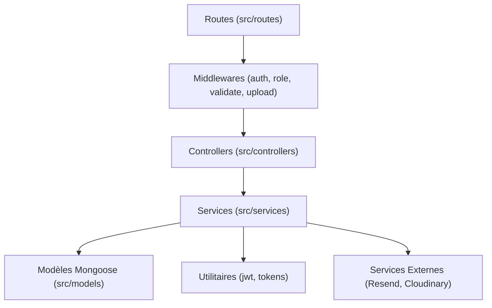
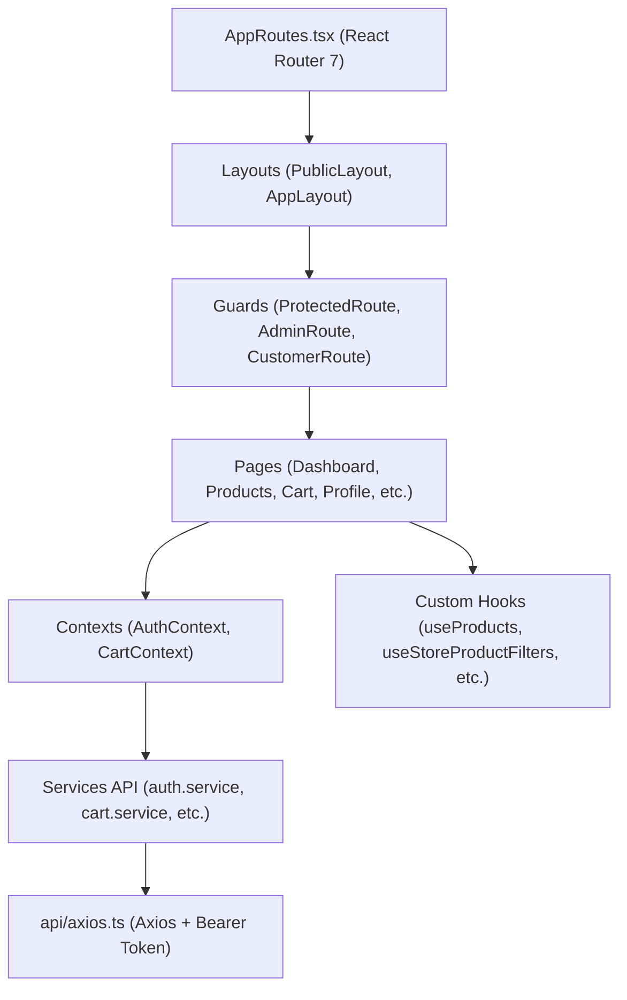

# 📐 Rapport de Qualité Logicielle, Architecture, Fiabilité & Maintenabilité — MarketElectro

**Date de réalisation** : 15 Octobre 2026  
**Cible** : Application MarketElectro (CodeAlpha_FS_01)  
**Auditeurs** : Senior Software Engineers (Node.js/Express & React/TypeScript)  
**Statut** : **Phase 1 — Audit en lecture seule**

---

## 1. Synthèse Globale de la Qualité du Code

Le projet MarketElectro présente une structure de base saine avec une séparation claire entre le frontend (React 19 / Vite / TailwindCSS / Radix) et le backend (Express 5 / TypeScript / Mongoose). Des efforts manifestes ont été apportés sur la modélisation des schémas de données, l'utilisation de transactions atomiques Mongoose pour les opérations sensibles (commandes, inscription, Google OAuth) et la validation par schémas Zod.

Cependant, le code souffre de plusieurs **défauts structurels de maintenabilité, d'incohérences de conception, de code mort et d'une dette technique notable** qui freinent sa maintenabilité et augmentent le coût des évolutions futures.

### Tableau Récapitulatif des Métriques de Santé du Code

| Métrique | État Observé | Évaluation |
|---|---|---|
| **Compilation TypeScript Backend** | 0 erreur (`tsc`) | ✅ Excellent |
| **Compilation TypeScript Frontend** | 0 erreur (`tsc -b && vite build`) | ✅ Excellent |
| **Conformité Lint Frontend** | **4 erreurs bloquantes** (`eslint .`) | ❌ À corriger immédiatement |
| **Couverture de Tests Automatisés** | **0%** (Aucun test unitaire, d'intégration ou E2E) | 🔴 Critique |
| **Duplication de Code & Routes** | Multiple (routes auth dans `user.routes.ts`, services dupliqués) | 🟠 Élevé |
| **Code Mort / Surfaces Inutilisées** | Module complet `/api/messages` non raccordé | 🟡 Moyen |
| **Gestion des Dépendances** | Outils de développement en dépendances de production | 🟡 Moyen |
| **Uniformité Linguistique** | Mélange permanent Français / Anglais (UI, API, Code) | 🟡 Moyen |
| **Journalisation (Logging)** | Appels `console.log` / `console.error` dispersés sans niveaux | 🟡 Moyen |

---

## 2. Analyse de l'Architecture et de la Modularité

### A. Backend (Express + TypeScript + Mongoose)

#### Points Forts de l'Architecture Backend
1. **Respect du pattern en couches (N-Tier)** : Les responsabilités sont en théorie bien découpées (Routes → Middlewares → Contrôleurs → Services métier → Modèles de données).
2. **Utilisation des Transactions Mongoose** : L'utilisation de `session.withTransaction(...)` sur les opérations critiques (`createOrder`, `registerUser`, `loginWithGoogle`, `updateAdminOrderStatus`) garantit l'intégrité ACID de la base de données.
3. **Séparation des schémas de validation** : Les schémas Zod sont centralisés dans le dossier `backend/src/schemas/`, ce qui évite la dispersion des règles de validation.

#### Défauts Architecturaux Backend & Duplications
1. **Duplication massive des routes d'authentification** :
   - Le fichier [`backend/src/routes/user.routes.ts`](file:///c:/Users/DELL/Downloads/SEMESTRE2025-2026/CODEALPHA/task1/backend/src/routes/user.routes.ts#L97-L190) contient une copie intégrale des routes de `auth.routes.ts` (lignes 97 à 190). Cette duplication crée deux points d'entrée concurrents pour chaque action d'authentification, complique la maintenance et brise la cohérence des politiques de sécurité.
   - De plus, dans [`backend/src/app.ts:L17, L181`](file:///c:/Users/DELL/Downloads/SEMESTRE2025-2026/CODEALPHA/task1/backend/src/app.ts#L17), `auth.routes` est importé une troisième fois sous le nom `contactRoutes` et monté sur `/api`.
2. **Duplication de logique métier entre services** :
   - La fonction `requestPasswordReset` est implémentée en double : à la fois dans [`backend/src/services/auth.services.ts:L378-L400`](file:///c:/Users/DELL/Downloads/SEMESTRE2025-2026/CODEALPHA/task1/backend/src/services/auth.services.ts#L378-L400) et dans [`backend/src/services/password.services.ts:L19-L92`](file:///c:/Users/DELL/Downloads/SEMESTRE2025-2026/CODEALPHA/task1/backend/src/services/password.services.ts#L19-L92).
   - Les contrôleurs `user.controllers.ts` et `auth.controllers.ts` importent et appellent ces fonctions de manière croisée.
3. **Absence de gestion centralisée des erreurs** :
   - Presque tous les contrôleurs répètent le même bloc `try { ... } catch (error: any) { res.status(400).json({ success: false, message: error.message }); }`.
   - Le middleware global de capture d'erreurs présent dans `app.ts` (lignes 190-200) n'est presque jamais atteint, car chaque contrôleur capture lui-même les exceptions et renvoie directement la réponse.
   - Conséquence : les erreurs internes Mongoose (ex: `CastError`, erreurs de validation interne) sont renvoyées brutes aux clients sans formatage unifié.
4. **Surface d'API Morte (Code Mort)** :
   - Le module de messagerie interne (`backend/src/routes/message.routes.ts`, `message.controllers.ts`, `message.services.ts`, modèles `Conversation.ts` et `Message.ts`) représente plus de 500 lignes de code complètes, documentées et fonctionnelles, mais **n'est relié à aucune interface frontend**.
   - Parallèlement, un système alternatif de contact a été initié (`contact.controllers.ts` et `ContactPage.tsx`), créant une redondance de conception non résolue.

---

### B. Frontend (React 19 + TypeScript + Vite + TailwindCSS)

#### Points Forts de l'Architecture Frontend
1. **Découpage composant shadcn/ui** : Bibliothèque d'UI moderne et accessible basée sur Radix Primitives.
2. **Contextes d'état bien isolés** : `AuthContext` et `CartContext` fournissent un état partagé clair pour les besoins globaux de la boutique.
3. **Mise à jour optimiste du panier et des favoris** : L'expérience utilisateur est réactive grâce aux hooks `useProductFavorites` et à la synchronisation d'état.

#### Défauts de Maintenabilité & Problèmes Détectés en Frontend
1. **Erreurs ESLint bloquantes (Règles `react-hooks/set-state-in-effect`)** :
   - [`frontend/src/contexts/CartContext.tsx:L117`](file:///c:/Users/DELL/Downloads/SEMESTRE2025-2026/CODEALPHA/task1/frontend/src/contexts/CartContext.tsx#L117) : Appel direct de `refreshCart()` dans un `useEffect` déclenchant des cascades de re-renders.
   - [`frontend/src/hooks/useAdminProducts.ts:L52`](file:///c:/Users/DELL/Downloads/SEMESTRE2025-2026/CODEALPHA/task1/frontend/src/hooks/useAdminProducts.ts#L52) : Appel synchrone de `loadProducts()` dans un effet.
   - [`frontend/src/pages/Dashboard.tsx:L40`](file:///c:/Users/DELL/Downloads/SEMESTRE2025-2026/CODEALPHA/task1/frontend/src/pages/Dashboard.tsx#L40) : Appel synchrone de `fetchDashboard()` dans un effet.
   - [`frontend/src/pages/ContactPage.tsx:L42`](file:///c:/Users/DELL/Downloads/SEMESTRE2025-2026/CODEALPHA/task1/frontend/src/pages/ContactPage.tsx#L42) : Utilisation du type `any` bannie par TypeScript ESLint.
2. **Recherche et Filtrage 100% Côté Client (Problème d'Évolutivité)** :
   - Le hook `useStoreProductFilters` charge **l'ensemble des produits** en mémoire dans le navigateur et applique les filtres textuels et de catégories en JavaScript.
   - Si cette approche est acceptable pour un prototype de 20 produits, elle devient inopérante et consommatrice de batterie dès que le catalogue atteint plusieurs centaines d'articles. Le filtrage et la recherche doivent être délégués à l'API via des paramètres de requête (`/api/products?search=...&category=...`).
3. **Absence d'Intercepteur Axios de Réponse (Gestion 401)** :
   - [`frontend/src/api/axios.ts`](file:///c:/Users/DELL/Downloads/SEMESTRE2025-2026/CODEALPHA/task1/frontend/src/api/axios.ts) injecte le token Bearer en requête, mais n'a **aucun intercepteur de réponse**.
   - Lorsqu'un token expire après 7 jours ou devient invalide, les requêtes API renvoient 401, mais l'utilisateur reste apparemment connecté dans le frontend (boutons visibles, état en localStorage non purgé), générant des erreurs silencieuses ou des notifications d'échec répétées.
4. **État d'Authentification Statique** :
   - Dans `AuthContext.tsx`, `loading` est codé en dur à `false` (`const loading = false;`). L'application ne procède à aucune vérification asynchrone auprès de `/api/auth/profile` ou `/api/users/me` au montage pour valider la session auprès du serveur.

---

## 3. Analyse des Dépendances et de la Chaîne d'Approvisionnement

### A. Backend

1. **Mauvais ciblage des dépendances** :
   - `nodemon: ^3.1.14` est installé dans `"dependencies"` au lieu de `"devDependencies"`. En production sur Render, l'application est lancée avec `node dist/server.js`, rendant `nodemon` et son arbre de dépendances volumineux (`chokidar`, `braces`, etc.) inutiles en environnement de production.
2. **Vulnérabilité critique de chaîne d'approvisionnement** :
   - `proxy-addr` (dépendance d'Express 5) est en version vulnérable (< 2.0.8) avec une faille d'usurpation d'IP (GHSA-jqcg-44mw-7w3h).

### B. Frontend

1. **Incohérences de paquets** :
   - `shadcn: ^4.16.2` (l'outil de ligne de commande shadcn) est placé dans `"dependencies"` au lieu de `"devDependencies"`. Il entraîne avec lui 20 signalements de vulnérabilité via `@ts-morph`, `fast-glob`, `undici`, etc.
   - `ts-node-dev: ^2.0.0` est installé dans les `"devDependencies"` du frontend. Un projet React/Vite s'exécutant dans le navigateur n'a aucunement besoin de `ts-node-dev`.

---

## 4. Uniformité du Code, Nommage et Internationalisation

1. **Mélange Permanent Anglais / Français** :
   - Modèles & Base de données : Noms de champs en anglais (`fullName`, `emailVerified`, `totalAmount`, `stock`).
   - Schémas & Messages d'erreur API : Messages en français (`"Le nom du produit est requis"`).
   - Statuts de commande : En anglais (`"pending"`, `"confirmed"`, `"cancelled"`).
   - Messages de contrôleur : En français (`"Commande créée avec succès"`).
   - Interface utilisateur (UI) : Textes mixtes dans les mêmes vues :
     - Sur `CheckoutPage.tsx` : Titre `"Checkout"`, sous-titre `"Review your order before continuing."`, bouton `"Place order"`, mais notification toast : `"Commande créée avec succès. Votre panier a été vidé."`
     - Sur `Products.tsx` : Titre `"Explorez nos Produits"`, champ de recherche `"Rechercher par nom..."`, badge `"X produits disponibles"`.
2. **Métadonnées HTML et SEO** :
   - [`frontend/index.html`](file:///c:/Users/DELL/Downloads/SEMESTRE2025-2026/CODEALPHA/task1/frontend/index.html) définit `<title>frontend</title>` et `<html lang="en">`, sans aucune balise `<meta name="description">`.
   - Il convient de configurer un titre valorisant la marque (`MarketElectro — Boutique Électronique en Ligne`), la langue adéquate (`fr`) et des métadonnées OpenGraph adaptées pour le référencement naturel.

---

## 5. Stratégie de Journalisation (Logging) et Observabilité

Actuellement, l'ensemble du projet s'appuie sur `console.log()` et `console.error()` standards :
- **Absence de niveaux de log** (Debug, Info, Warn, Error).
- **Absence de format structuré (JSON)** : Les logs sur Render s'affichent sous forme de texte brut avec des émojis (`✅ MongoDB connecté`, `❌ Erreur non gérée :`), ce qui empêche tout filtrage, agrégation ou monitoring automatisé via Datadog, Grafana ou CloudWatch.
- **Risque d'oubli de traces sensibles** : `test-User.ts` affiche directement l'objet utilisateur complet (`console.log(user)`).

**Recommandation** : Adopter un logger structuré et performant tel que `pino` avec un format JSON en production et une coloration lisible en développement (`pino-pretty`).

---

## 6. Plan d'Action Qualité & Maintenabilité Priorisé

### Lot 1 — Correction Immédiate des Erreurs et de l'Hygiène du Code (Effort : 2h)
1. **Corriger les 4 erreurs ESLint du frontend** :
   - Modifier `CartContext.tsx`, `useAdminProducts.ts` et `Dashboard.tsx` pour envelopper les initialisations dans des fonctions asynchrones propres sans déclenchement synchrone immédiat de `setState`.
   - Typer proprement les paramètres dans `ContactPage.tsx`.
2. **Nettoyer les `package.json`** :
   - Déplacer `nodemon` vers `devDependencies` dans le backend.
   - Déplacer `shadcn` vers `devDependencies` et retirer `ts-node-dev` dans le frontend.

### Lot 2 — Refactorisation des Routes & Élimination de la Duplication (Effort : 3h)
1. Nettoyer `backend/src/routes/user.routes.ts` en retirant les 95 lignes de routes auth dupliquées.
2. Corriger `backend/src/app.ts` pour supprimer le montage pirate de `contactRoutes` sur `/api`.
3. Supprimer l'implémentation dupliquée de `requestPasswordReset` dans `auth.services.ts` pour ne conserver que celle de `password.services.ts`.

### Lot 3 — Fiabilisation du Cycle de Session & Client API (Effort : 4h)
1. Ajouter un intercepteur de réponse dans `frontend/src/api/axios.ts` qui capture les erreurs HTTP 401, purge le `localStorage` et redirige l'utilisateur vers `/login` avec un message d'information.
2. Ajouter une vérification de session active au montage dans `AuthContext.tsx`.

### Lot 4 — SEO, Internationalisation & Uniformité UX (Effort : 3h)
1. Mettre à jour `frontend/index.html` (titre, description, balises meta, favicon).
2. Standardiser la langue des boutons et libellés dans le tunnel d'achat et le tableau de bord (priorité au français pour la cohérence avec le reste du site).

### Lot 5 — Évolutivité & Pagination (Effort : 1 jour)
1. Mettre en place la pagination (`page`, `limit`) sur `GET /api/products`, `GET /api/admin/orders` et `GET /api/admin/users`.
2. Adapter le hook `useProducts` pour supporter le chargement paginé ou l'infinite scroll.

### Lot 6 — Mise en Place d'un Socle de Tests Automatisés (Effort : 2 jours)
1. Installer `vitest` et `supertest` côté backend.
2. Écrire une suite de tests unitaires et d'intégration validant :
   - L'inscription et la connexion.
   - Le contrôle d'accès sur `/api/admin/*` (rejet d'un token customer avec HTTP 403).
   - L'isolation des données sur `/api/orders` et `/api/cart`.
